# Vertical Slice Architecture Template


A pragmatic **Vertical Slice Architecture** starter for **.NET 10**: one Web API project, organized by **feature** instead of by **layer**. Batteries included, opinionated where it matters, and easy to extend.

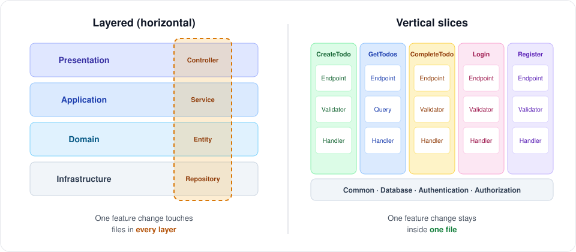

## Table of contents

- [What is Vertical Slice Architecture?](#what-is-vertical-slice-architecture)
- [What's included](#whats-included)
- [Architecture at a glance](#architecture-at-a-glance)
- [Project structure](#project-structure)
- [Anatomy of a slice](#anatomy-of-a-slice)
- [Life of a request](#life-of-a-request)
- [Building blocks](#building-blocks)
  - [Middleware pipeline](#middleware-pipeline)
  - [Handler decorators](#handler-decorators)
  - [Results and errors](#results-and-errors)
  - [Domain events](#domain-events)
  - [Caching](#caching)
  - [Authentication and authorization](#authentication-and-authorization)
  - [Rate limiting and idempotency](#rate-limiting-and-idempotency)
  - [Observability](#observability)
- [Data model](#data-model)
- [API endpoints](#api-endpoints)
- [Dependency rules](#dependency-rules)
- [Testing strategy](#testing-strategy)
- [Pros and cons](#pros-and-cons)
- [When to use it (and when not to)](#when-to-use-it-and-when-not-to)
- [Getting started](#getting-started)
- [Adding a feature](#adding-a-feature)
- [Configuration](#configuration)
- [Author](#author)

---

## What is Vertical Slice Architecture?

In a classic **layered** (or Clean/Onion) architecture, code is grouped by *technical role*: controllers in one place, services in another, repositories in a third. Adding a single feature means touching every layer.

**Vertical Slice Architecture (VSA)** turns that 90°. Code is grouped by *use case*. Everything one request needs (the input contract, validation, business logic, data access and HTTP mapping) lives together in **one slice**. Slices share a thin, deliberately small foundation (`Common`, `Database`, auth), but they don't share each other.

> **Core idea:** minimize coupling *between* slices, maximize cohesion *within* a slice.

| | Layered / Clean | Vertical slices (this template) |
|---|---|---|
| Unit of organization | Technical layer | Use case (feature) |
| Files touched to add a feature | 4–8 across several projects | **1 file** (+ tests) |
| Abstractions | Repositories, services, interfaces per layer | Only where they pay off (`ICommandHandler`, `IUserContext`, ...) |
| Data access | Through repository interfaces | `ApplicationDbContext` injected directly |
| Code reuse | Encouraged across layers | Explicitly limited across slices |
| Projects in the solution | 4+ (Domain, Application, Infrastructure, Web) | **1** (`Web.Api`) + tests |

---

## What's included

- **Features** (`Features/{Entity}/`): each use case is **one file**, a `public static class {UseCase}` with a nested command/query, validator, handler and endpoint. Sample `Todos` and `Users` features are included.
- **CQRS without MediatR**: lightweight `ICommand`/`IQuery` + `ICommandHandler`/`IQueryHandler` abstractions (`Common/Messaging/`), discovered by **Scrutor** assembly scanning.
- **Cross-cutting concerns as decorators**: logging and validation (`Common/Behaviors/`) wrap every handler without the handler knowing.
- **Result pattern**: `Result`/`Result<T>` + `Error` instead of exceptions for expected failures, translated to RFC 7807 `ProblemDetails`.
- **Persistence** (`Database/`): EF Core 10 + PostgreSQL 17, snake_case naming, migrations, auto-applied entity configurations, and a domain-events dispatcher.
- **Authentication**: JWT access tokens + **refresh tokens with rotation**.
- **Authorization**: permission-based policies (`.HasPermission("users:access")`).
- **HybridCache**: fast, unified caching with explicit invalidation.
- **Web API concerns**: auto-discovered Minimal API endpoints, **rate limiting** (global + stricter auth policy), opt-in **idempotency**, security headers, CORS, global exception handling, health checks, and a **Scalar** API reference with JWT support.
- **Observability**: Serilog structured logs + OpenTelemetry traces and metrics, shipped over OTLP to **Grafana + Loki + Tempo + Prometheus** (`grafana/otel-lgtm`).
- **Testing**: unit tests, integration tests with **Testcontainers**, and architecture tests with **NetArchTest**.
- **Quality gates**: `TreatWarningsAsErrors`, `AnalysisMode=All`, SonarAnalyzer, central package management, and a GitHub Actions build.
- **Claude Code skills** (`.claude/skills/`): `/add-feature`, `/add-entity`, `/add-tests`, `/add-migration`, `/add-background-job`, `/bootstrap`, `/vsa-review`.

---

## Architecture at a glance

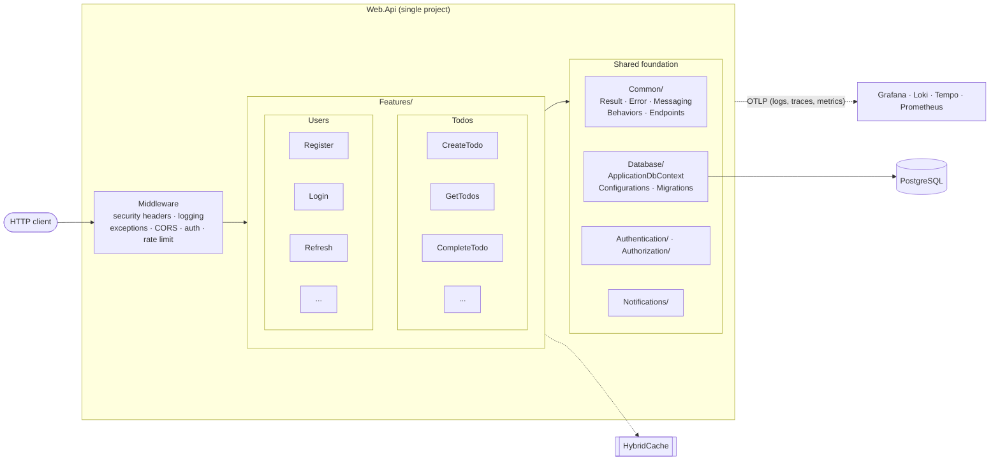

Requests pass through the middleware pipeline, hit exactly **one slice**, and that slice talks to the shared foundation and the database directly. Slices never call each other.

---

## Project structure

```text
.
├── src/
│   └── Web.Api/
│       ├── Features/                    # one folder per feature, one file per use case
│       │   ├── Todos/
│       │   │   ├── CreateTodo.cs        # Command + Validator + Handler + Endpoint
│       │   │   ├── GetTodos.cs          # Query + Response + Handler + Endpoint
│       │   │   ├── GetTodoById.cs  UpdateTodo.cs  CompleteTodo.cs  CopyTodo.cs  DeleteTodo.cs
│       │   │   ├── TodoItem.cs          # entity
│       │   │   ├── TodoItemErrors.cs    # error catalog ("Todos.NotFound", ...)
│       │   │   ├── TodoItem*DomainEvent.cs
│       │   │   ├── TodoCacheKeys.cs     # cache key helpers
│       │   │   └── Priority.cs
│       │   └── Users/
│       │       ├── Register.cs  Login.cs  Refresh.cs  GetUserById.cs  GetUserByEmail.cs
│       │       ├── User.cs  RefreshToken.cs  UserErrors.cs  Permissions.cs
│       │       └── UserRegisteredDomainEvent.cs
│       ├── Common/                      # cross-cutting building blocks
│       │   ├── Messaging/               # ICommand, IQuery, ICommandHandler, IQueryHandler
│       │   ├── Behaviors/               # ValidationDecorator, LoggingDecorator
│       │   ├── Endpoints/               # IEndpoint, Tags, MapEndpoints, HasPermission, WithIdempotency
│       │   ├── Middleware/              # security headers, request-context logging
│       │   ├── Extensions/              # OpenTelemetry, rate limiting, migrations, results
│       │   └── Result.cs  Error.cs  Entity.cs  PagedList.cs  IdempotencyFilter.cs ...
│       ├── Database/                    # ApplicationDbContext, Configurations/, Migrations/, events dispatcher
│       ├── Authentication/              # JWT, refresh tokens, password hashing, IUserContext
│       ├── Authorization/               # permission policies + handler
│       ├── Notifications/               # IEmailSender (+ logging implementation)
│       ├── DependencyInjection.cs       # AddApplication / AddPresentation / AddInfrastructure
│       └── Program.cs
├── tests/
│   ├── Web.Api.UnitTests/               # handler + validator tests
│   ├── IntegrationTests/                # real HTTP + real PostgreSQL via Testcontainers
│   └── ArchitectureTests/               # NetArchTest convention rules
├── docker-compose.yml                   # API + PostgreSQL + Grafana LGTM stack
├── Directory.Build.props                # target framework, analyzers, warnings-as-errors
└── Directory.Packages.props             # central NuGet versions
```

---

## Anatomy of a slice

Every use case is a single `public static class` that nests all of its parts. Here is the shape of [`CreateTodo.cs`](src/Web.Api/Features/Todos/CreateTodo.cs), trimmed:

```csharp
namespace Web.Api.Features.Todos;

public static class CreateTodo
{
    // 1. The input contract
    public sealed class Command : ICommand<Guid>
    {
        public Guid UserId { get; set; }
        public string Description { get; set; }
        public Priority Priority { get; set; }
        // ...
    }

    // 2. Validation (commands only), run automatically by ValidationDecorator
    public sealed class Validator : AbstractValidator<Command>
    {
        public Validator()
        {
            RuleFor(c => c.Description).NotEmpty().MaximumLength(255);
            RuleFor(c => c.Priority).IsInEnum();
        }
    }

    // 3. Business logic, with ApplicationDbContext injected directly
    internal sealed class Handler(ApplicationDbContext context, IUserContext userContext, IDateTimeProvider clock)
        : ICommandHandler<Command, Guid>
    {
        public async Task<Result<Guid>> Handle(Command command, CancellationToken ct)
        {
            if (userContext.UserId != command.UserId)
            {
                return Result.Failure<Guid>(UserErrors.Unauthorized());
            }

            var todo = new TodoItem { /* ... */ CreatedAt = clock.UtcNow };
            todo.Raise(new TodoItemCreatedDomainEvent(todo.Id));

            context.TodoItems.Add(todo);
            await context.SaveChangesAsync(ct);

            return todo.Id;
        }
    }

    // 4. HTTP mapping, auto-discovered by AddEndpoints()
    public sealed class Endpoint : IEndpoint
    {
        public void MapEndpoint(IEndpointRouteBuilder app) =>
            app.MapPost("todos", async (Request request, ICommandHandler<Command, Guid> handler, CancellationToken ct) =>
                {
                    Result<Guid> result = await handler.Handle(/* map request -> command */, ct);
                    return result.Match(Results.Ok, CustomResults.Problem);
                })
                .WithTags(Tags.Todos)
                .WithIdempotency()
                .RequireAuthorization();
    }
}
```

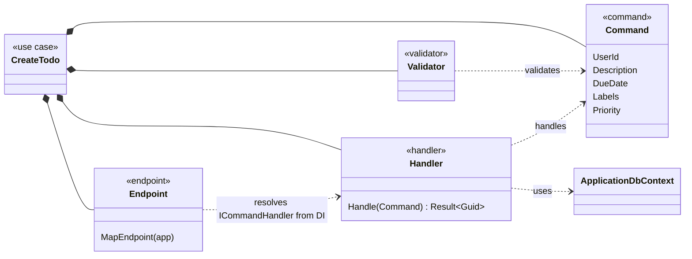

**Nothing is wired by hand.** Handlers are registered by Scrutor scanning, validators by `AddValidatorsFromAssembly(includeInternalTypes: true)`, endpoints by `AddEndpoints(...)`, EF configurations by `ApplyConfigurationsFromAssembly`, and domain-event handlers by scanning. Adding a file is enough.

---

## Life of a request

What happens on `POST /todos`, end to end:

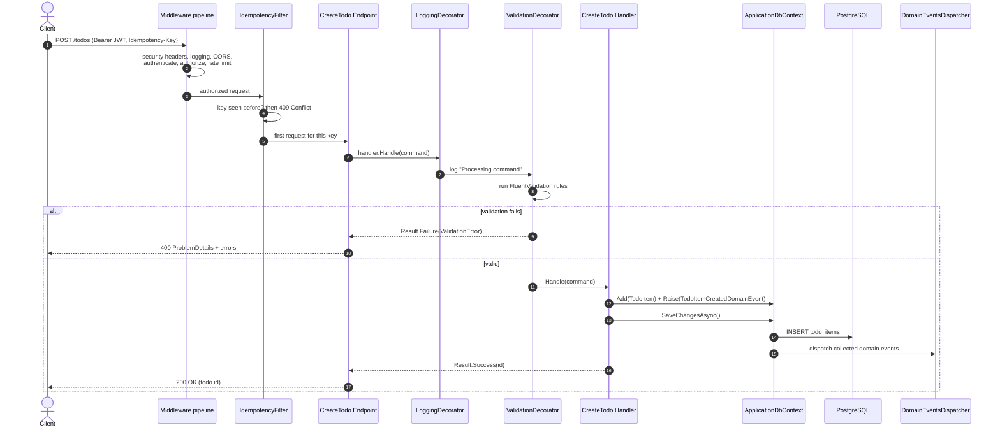

---

## Building blocks

### Middleware pipeline

Registered in [`Program.cs`](src/Web.Api/Program.cs) in this order:

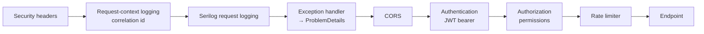

Health checks are exposed at `/health` (including PostgreSQL). In Development the app also serves OpenAPI, the Scalar UI at `/scalar/v1`, and applies EF migrations on startup.

### Handler decorators

Handlers stay focused on business logic. Cross-cutting behavior is layered around them with Scrutor's `Decorate`, which gives you the pipeline-behavior pattern without MediatR:

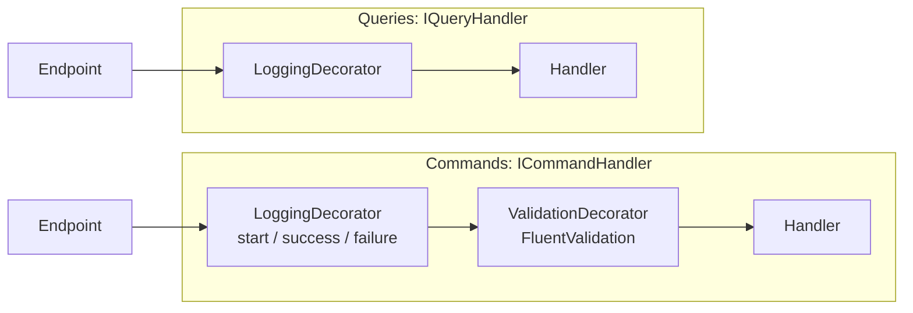

Queries skip validation by convention. They read data and should not need it.

### Results and errors

Expected failures are **values, not exceptions**. Handlers return `Result`/`Result<T>`; each feature owns a static error catalog (`TodoItemErrors`, `UserErrors`) with codes like `"Todos.NotFound"`. Endpoints translate with `result.Match(Results.Ok, CustomResults.Problem)`:

| `ErrorType` | HTTP status | Example |
|---|---|---|
| `Validation` | **400** Bad Request (+ `errors` array) | Description is empty |
| `Problem` | **400** Bad Request | Business rule violated |
| `NotFound` | **404** Not Found | `Todos.NotFound` |
| `Conflict` | **409** Conflict | `Users.EmailNotUnique` |
| `Failure` | **500** Internal Server Error | Unexpected failure |

Unhandled exceptions are caught by `GlobalExceptionHandler` and returned as a generic 500 `ProblemDetails`, so internal details don't leak.

### Domain events

Entities derive from `Entity` and call `Raise(...)`. `ApplicationDbContext.SaveChangesAsync` collects the events, **saves first**, then dispatches each event to every `IDomainEventHandler<T>` in its own DI scope:

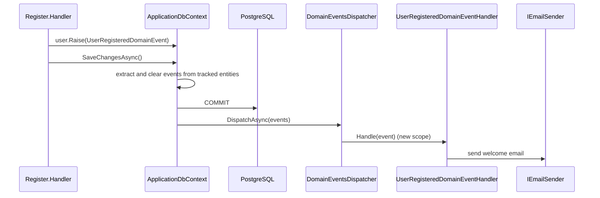

Because events are published **after** the commit, side effects are *eventually consistent*: a failing handler does not roll back the save. When you need guaranteed delivery, the natural next step is an **outbox** table processed by a background job (`/add-background-job`).

### Caching

`HybridCache` gives a single API over in-memory (L1) and optional distributed (L2) caches with stampede protection. Each feature owns its keys (`TodoCacheKeys.ById(userId, todoId)`), and **the commands that mutate data invalidate them**:

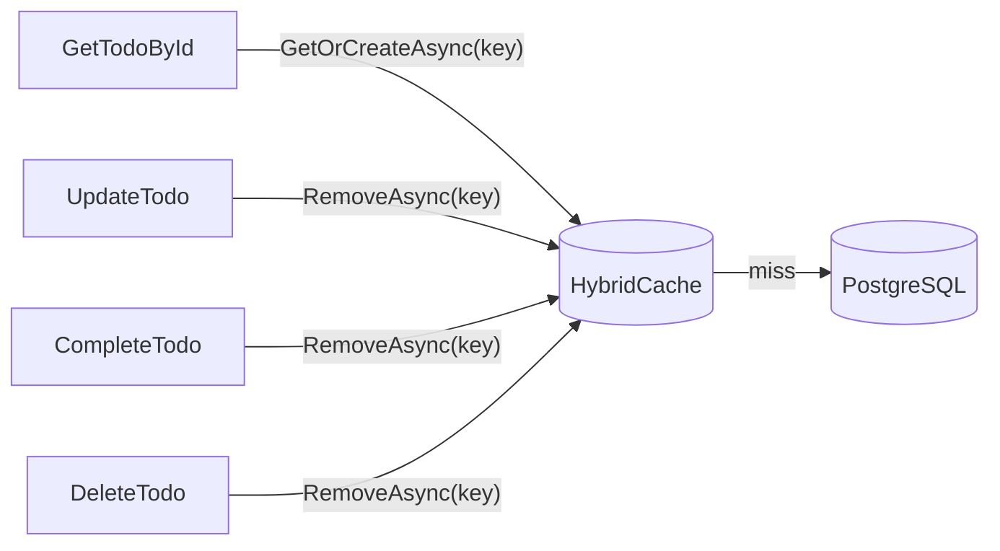

Cache keys include the user id, so one user can never be served another user's cached item.

### Authentication and authorization

- **JWT bearer** access tokens (`ClockSkew = 0`) signed with a symmetric key from configuration.
- **Refresh tokens** are stored in the database and **rotated on every use**, so a stolen refresh token works at most once.
- **`IUserContext`** exposes the current user id to handlers; handlers enforce ownership (`userContext.UserId == command.UserId`).
- **Permission-based authorization**: `.HasPermission("users:access")` creates a policy on demand through `PermissionAuthorizationPolicyProvider`, checked by `PermissionAuthorizationHandler` against `PermissionProvider`.

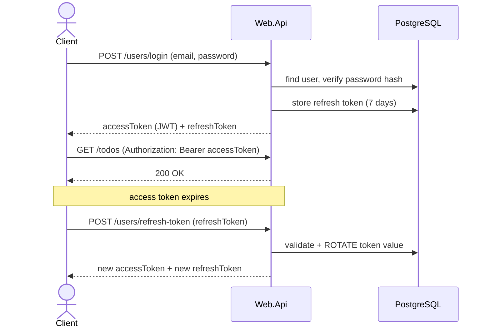

> `PermissionProvider.GetForUserIdAsync` is a **stub** that returns no permissions. Plug in your own role/permission lookup before relying on `.HasPermission(...)` endpoints.

### Rate limiting and idempotency

- **Global fixed-window limiter**: 100 requests / 60 s, partitioned by authenticated user (or client IP when anonymous).
- **`Authentication` policy**: 10 requests / 60 s on `register`, `login` and `refresh-token` to slow down brute-force attempts. Exceeding either returns **429**.
- **Idempotency** (opt-in per endpoint with `.WithIdempotency()`): if a request carries an `Idempotency-Key` header, the key is remembered for one hour and a repeat returns **409 Conflict**. Requests without the header are processed normally.

### Observability

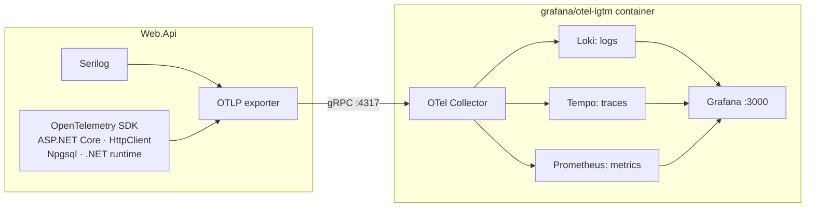

Every log line carries the trace id, so in Grafana you can jump from a slow trace to the exact logs of that request and back.

---

## Data model

Entities reference each other by **foreign-key ids**; tables live in the `public` schema with snake_case names.

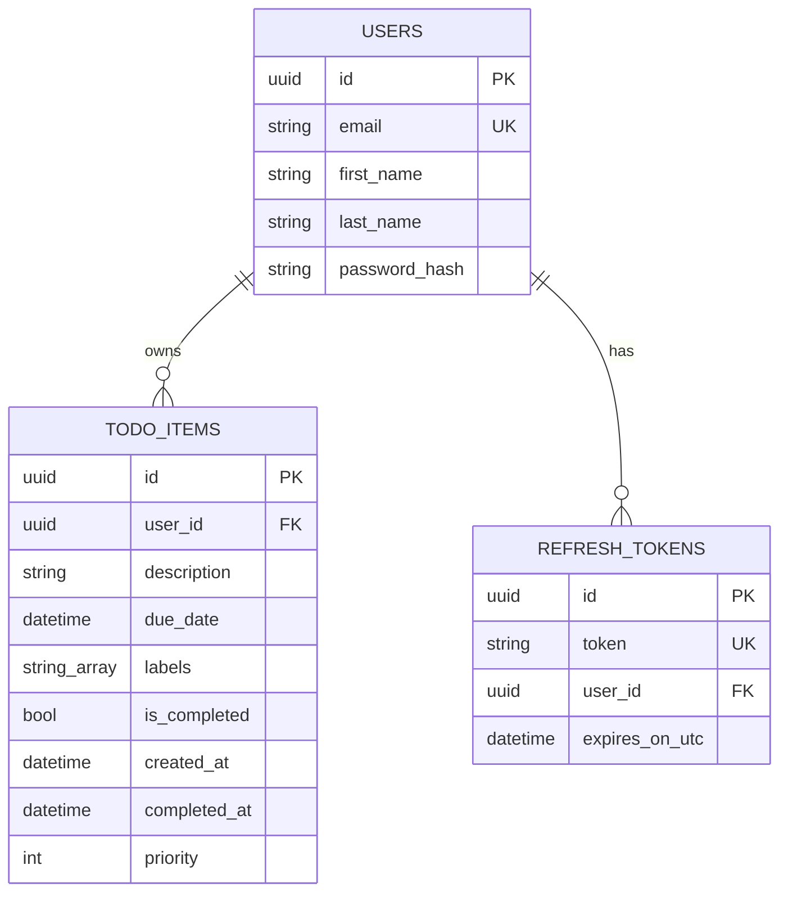

---

## API endpoints

| Method | Route | Slice | Protection |
|---|---|---|---|
| `POST` | `/users/register` | `Register` | Auth rate limit |
| `POST` | `/users/login` | `Login` | Auth rate limit |
| `POST` | `/users/refresh-token` | `Refresh` | Auth rate limit |
| `GET` | `/users/{userId}` | `GetUserById` | Permission `users:access` |
| `GET` | `/todos` | `GetTodos` (search, sort, paging) | JWT |
| `GET` | `/todos/{id}` | `GetTodoById` (cached) | JWT |
| `POST` | `/todos` | `CreateTodo` | JWT + idempotency |
| `PUT` | `/todos/{id}` | `UpdateTodo` | JWT |
| `PUT` | `/todos/{id}/complete` | `CompleteTodo` | JWT |
| `POST` | `/todos/{todoId}/copy` | `CopyTodo` | JWT |
| `DELETE` | `/todos/{id}` | `DeleteTodo` | JWT |
| `GET` | `/health` | — | Public |

List queries return `PagedList<T>` and project to a nested `Response` DTO with `.Select(...)`. Entities never leave a handler.

---

## Dependency rules

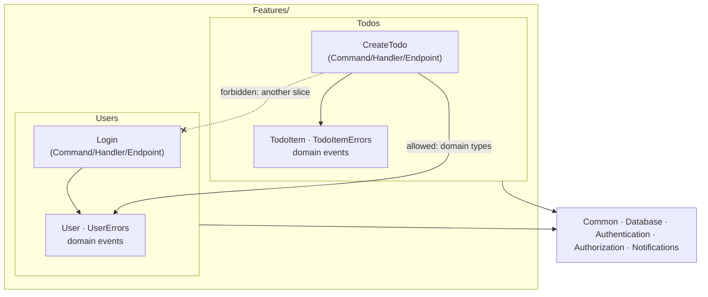

1. **A slice may use** the shared foundation and *another feature's domain types* (entity, `{Entity}Errors`, domain events).
2. **A slice may never use** another feature's `Command`/`Query`/`Handler`/`Validator`/`Endpoint`. If two slices need the same logic, push it down into the entity or `Common`, or simply duplicate it.
3. **Handlers and endpoints are `sealed`.** This is enforced by `ArchitectureTests`.
4. **No `IApplicationDbContext`, no repositories.** Handlers inject `ApplicationDbContext` directly.

---

## Testing strategy

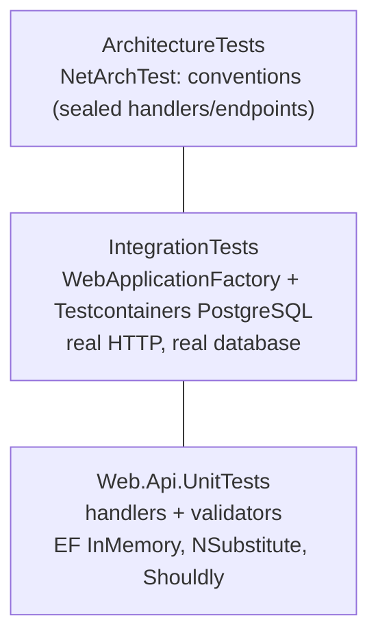

| Project | What it proves | Speed | Needs Docker |
|---|---|---|---|
| `Web.Api.UnitTests` | Handler logic and validator rules in isolation | Fast | No |
| `IntegrationTests` | The full slice through HTTP, auth, validation and a real PostgreSQL | Slower | **Yes** |
| `ArchitectureTests` | Structural conventions stay intact | Fast | No |

Because a slice is one file, its tests map to it one-to-one (`CreateTodoHandlerTests`, `TodoValidatorsTests`, `TodosTests`).

---

## Pros and cons

### Pros

| Advantage | Why it matters |
|---|---|
| **High cohesion** | Everything about a use case is in one file. You read it top to bottom and understand the feature. |
| **Low coupling** | Changing `CompleteTodo` can't break `GetTodos`. Blast radius stays small. |
| **Fast feature delivery** | New feature = new file. No ceremony across 4 projects. |
| **Per-slice freedom** | A simple query can be 10 lines of LINQ; a complex command can grow a rich domain model. Each slice picks the complexity it needs. |
| **Easy onboarding** | Folders mirror the product, so "where is the login logic?" has an obvious answer. |
| **Fewer abstractions** | No repository/service/interface triplets wrapping EF Core. Less indirection, less code. |
| **Parallel teamwork** | Developers working on different slices rarely touch the same files, which means fewer merge conflicts. |
| **Testable** | Handlers are plain classes with injected dependencies; integration tests exercise one endpoint at a time. |
| **Extractable** | A feature folder is a natural boundary if you later move to a modular monolith or a microservice. |

### Cons

| Trade-off | Mitigation in this template |
|---|---|
| **Possible code duplication** between similar slices | Accepted on purpose; shared logic goes into the entity, `Common`, or a domain service only once the duplication is real. |
| **Business rules can scatter** into handlers ("anemic" entities) | Put invariants on entities (`TodoItem`, `User`) and raise domain events; keep handlers as orchestration. |
| **Requires discipline**: nothing in the compiler stops slice-to-slice calls | Conventions in `CLAUDE.md`, `/vsa-review`, and `ArchitectureTests` (extend them with your own rules). |
| **Direct `DbContext` use couples slices to EF Core** | A deliberate trade: EF Core already *is* a unit of work + repository. Integration tests run against real PostgreSQL. |
| **Shared database schema** means slices are not fully independent | Fine for a monolith; split schemas per module if you grow into a modular monolith. |
| **Files can grow large** for complex use cases | Extract private helpers or domain methods; a 300-line slice is a signal to push logic into the entity. |
| **Less familiar** to teams used to N-tier/Clean Architecture | The one-file-per-use-case rule is easy to learn, and the skills generate slices in the house style. |
| **Single project** gives no compile-time layer boundaries | Use architecture tests; split into modules/projects only when the codebase actually needs it. |

---

## When to use it (and when not to)

**A great fit when...**
- the app is mostly **request/response use cases** (CRUD plus business rules), such as APIs, SaaS back ends and internal tools;
- you want to **ship features quickly** with a small-to-medium team;
- requirements change often and you want changes to stay **local**.

**Think twice when...**
- the domain is **extremely rich** with many invariants spanning aggregates. Combine VSA with DDD tactical patterns rather than replacing them;
- you need **multiple delivery mechanisms** sharing the exact same use cases (e.g. HTTP + gRPC + CLI). Extract the handlers and keep the endpoints thin;
- many teams need **hard boundaries**. Evolve towards a **modular monolith** (one module per feature group, each with its own slices).

---

## Getting started

**Prerequisites:** [.NET 10 SDK](https://dotnet.microsoft.com/download) and [Docker](https://www.docker.com/).

```bash
# Run everything (API + PostgreSQL + Grafana LGTM) in containers
docker compose up -d --build
```

| Service | URL |
|---|---|
| API | http://localhost:5000 |
| Scalar API reference | http://localhost:5000/scalar/v1 |
| Health check | http://localhost:5000/health |
| Grafana (logs, traces, metrics) | http://localhost:3000 |
| PostgreSQL | `localhost:5432` (postgres / postgres) |

You can also start the `docker-compose` profile from Visual Studio. To run the API directly on your machine (`dotnet run --project src/Web.Api`) while PostgreSQL stays in Docker, point `ConnectionStrings:Database` at `Host=localhost` instead of the `postgres` service name.

**Build and test:**

```bash
dotnet build VerticalSlice.slnx
dotnet test  VerticalSlice.slnx   # integration tests start a throwaway PostgreSQL container, so Docker must be running
```

To target .NET 8 or .NET 9 instead of .NET 10, see the notes in [`Directory.Build.props`](Directory.Build.props).

---

## Adding a feature

1. Create `Features/{Entity}/{UseCase}.cs` with a `public static class {UseCase}`.
2. Nest a `Command` (or `Query`), a `Validator` (commands only), an `internal sealed Handler`, and a `sealed Endpoint : IEndpoint`.
3. Return `Result.Failure(...)` with an error from the feature's `{Entity}Errors` catalog for expected failures.
4. If the command changes cached data, invalidate the feature's cache keys.
5. Add unit and integration tests.

That's it. Scanning registers the handler, validator and endpoint automatically.

With Claude Code, the bundled skills do this in the house style:

```text
/add-feature snooze a todo until a given date
/add-entity  Project with a name and owner
/add-migration AddProjects
/vsa-review
```

See [`.claude/skills/README.md`](.claude/skills/README.md) for details.

---

## Configuration

Key settings (`appsettings*.json`, environment variables or user secrets):

| Key | Purpose | Default |
|---|---|---|
| `ConnectionStrings:Database` | PostgreSQL connection string | Docker `postgres` service in Development |
| `Jwt:Secret` / `Issuer` / `Audience` | Token signing and validation | **Change the secret.** Keep it in user secrets or a vault |
| `Jwt:ExpirationInMinutes` | Access-token lifetime | `60` in Development |
| `Cors:AllowedOrigins` | Allowed browser origins | `[]` |
| `RateLimiting:Global:*` | Global limiter permit/window | `100` / `60s` |
| `RateLimiting:Authentication:*` | Auth endpoint limiter permit/window | `10` / `60s` |
| `Serilog:*` | Log levels and sinks (console + OTLP) | Information |

---

## Author

Created and maintained by **Ramazan Abdullah**.
